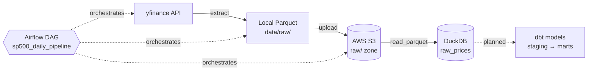

# 📈 S&P 500 ETL Pipeline


A batch data pipeline that extracts daily stock prices for S&P 500 companies with **yfinance**, stores them as **Parquet** in an **AWS S3** data lake, loads them into a **DuckDB** warehouse and orchestrates the workflow with **Apache Airflow**.

The project is designed to run at **zero cost** during development: S3 stays within the free tier, and the warehouse and orchestrator run locally. Production alternatives are documented in [Scaling to production](#scaling-to-production).

---

## 📋 Table of Contents

- [Architecture](#architecture)
- [Tech Stack and Design Decisions](#tech-stack-and-design-decisions)
- [Project Structure](#project-structure)
- [Data Model](#data-model)
- [Setup](#setup)
- [Running the Pipeline](#running-the-pipeline)
- [Roadmap](#roadmap)
- [Scaling to production](#scaling-to-production)
- [Limitations](#limitations)

---

## Architecture



| Stage | Component | Status |
|---|---|---|
| **Extract** | `extract/get_prices.py` downloads OHLCV prices with yfinance | ✅ Done |
| **Store (local)** | Saves a date-stamped Parquet file to `data/raw/` | ✅ Done |
| **Store (lake)** | Uploads the file to `s3://<bucket>/raw/` with boto3 | ✅ Done |
| **Load** | `load/load_to_warehouse.py` reads every Parquet file in S3 into DuckDB (`raw_prices`) | ✅ Done (run manually) |
| **Orchestrate** | Airflow DAG with `extract → save_locally → upload`, daily schedule, 3 retries | ✅ Done |
| **Transform** | dbt staging and mart models in DuckDB | 🔜 Planned |

---

## Tech Stack and Design Decisions

| Layer | Choice | Why | Alternative considered |
|---|---|---|---|
| Source | yfinance | Free, no API key, daily OHLCV data | Alpha Vantage, Polygon (rate limits / paid tiers) |
| File format | Parquet | Columnar, compressed, schema-aware; read natively by DuckDB | CSV (no types, larger files) |
| Data lake | AWS S3 | Industry-standard object storage; free tier is enough for this volume | Local disk only |
| Access control | IAM user with a least-privilege policy scoped to one bucket | The pipeline can only read/write its own bucket | Root / admin credentials (unsafe) |
| Warehouse | DuckDB | Zero cost, columnar, queries Parquet directly from S3 | Redshift, Snowflake, Postgres |
| Orchestration | Airflow 3 (TaskFlow API, standalone mode) | De facto standard for batch orchestration; standalone mode avoids Docker on macOS 12 | MWAA, Dagster, Prefect |
| Transformation | dbt (planned) | SQL models with tests, documentation and lineage | Pandas transformations |

---

## Project Structure

```
sp500-etl-pipeline/
├── dags/
│   └── sp500_pipeline.py      # Airflow DAG: extract → save_locally → upload
├── extract/
│   └── get_prices.py          # yfinance extraction, local Parquet, S3 upload
├── load/
│   └── load_to_warehouse.py   # S3 Parquet → DuckDB raw_prices table
├── data/
│   └── raw/                   # Local Parquet files (git-ignored)
├── test_data.py               # Quick manual check of the yfinance download
├── requirements.txt
└── README.md
```

---

## Data Model

### `raw_prices` (DuckDB)

One row per trading day, loaded from all Parquet files under `s3://<bucket>/raw/`.

yfinance returns a wide table with a **two-level column index** (price field × ticker), so columns arrive in DuckDB as tuples such as `('Close', 'AAPL')`. Reshaping this into a tidy long table is the first job of the planned dbt staging model:

| Planned model | Grain | Columns |
|---|---|---|
| `stg_prices` | one row per ticker per day | `date`, `ticker`, `open`, `high`, `low`, `close`, `volume` |
| `fct_daily_returns` | one row per ticker per day | `date`, `ticker`, `close`, `daily_return`, `rolling_volatility_20d` |

---

## Setup

**Requirements:** Python 3.12, an AWS account and the AWS CLI.

```bash
git clone https://github.com/iMalcolmS/sp500-etl-pipeline.git
cd sp500-etl-pipeline
python3 -m venv venv
source venv/bin/activate
pip install -r requirements.txt
```

### AWS

1. Create an S3 bucket.
2. Create an IAM user whose policy only allows `s3:ListBucket`, `s3:GetObject` and `s3:PutObject` on that bucket.
3. Configure the credentials locally with `aws configure`.
4. Set `BUCKET_NAME` in `extract/get_prices.py`, `load/load_to_warehouse.py` and `dags/sp500_pipeline.py` to your bucket name.

### Airflow (standalone)

```bash
export AIRFLOW_HOME=~/airflow
airflow standalone
```

Point Airflow's `dags_folder` (in `~/airflow/airflow.cfg`) to this repository's `dags/` folder, then open the UI at http://localhost:8080.

---

## Running the Pipeline

**Manually, step by step:**

```bash
python extract/get_prices.py        # yfinance → data/raw/*.parquet → S3
python load/load_to_warehouse.py    # S3 → DuckDB (warehouse.duckdb)
```

**With Airflow:** enable and trigger the `sp500_daily_pipeline` DAG in the UI. It runs daily with up to 3 retries per task.

**Query the warehouse:**

```bash
python -c "import duckdb; print(duckdb.connect('warehouse.duckdb').sql('SELECT COUNT(*) FROM raw_prices'))"
```

---

## Roadmap

- [ ] Add the `load` step to the Airflow DAG so the whole pipeline runs end to end
- [ ] dbt project: `stg_prices` (flatten the multi-index columns) and `fct_daily_returns`
- [ ] dbt tests: `not_null` and `unique` on (`date`, `ticker`), accepted ranges for prices
- [ ] Unit tests with pytest for extraction and loading
- [ ] GitHub Actions CI (lint + tests)
- [ ] Incremental loads instead of rebuilding `raw_prices` on every run
- [ ] Expand from 5 tickers to the full S&P 500 constituent list
- [ ] Configuration through environment variables instead of hard-coded bucket names and paths

---

## Scaling to production

The local setup keeps costs at zero. In production, the same design would map to:

| Local | Production option |
|---|---|
| Airflow standalone | Amazon MWAA or Airflow on Kubernetes |
| DuckDB file | Amazon Redshift, Snowflake or MotherDuck |
| Manual AWS setup | Infrastructure as code with Terraform |
| Local credentials | IAM roles attached to the compute running the pipeline |

---

## Limitations

- **Ticker coverage:** the pipeline currently tracks 5 large-cap S&P 500 stocks (AAPL, MSFT, GOOGL, AMZN, NVDA), not the full index.
- **Full reload:** `raw_prices` is rebuilt from every file in S3 on each load.
- **Local paths:** the DAG adds the project folder to `sys.path` with an absolute local path.
- **Data source:** yfinance is an unofficial wrapper around Yahoo Finance and can change or rate-limit without notice.

---

## Author

**Malcolm**: MSc Artificial Intelligence (First Class Honours), University of West London  
[GitHub](https://github.com/iMalcolmS)
